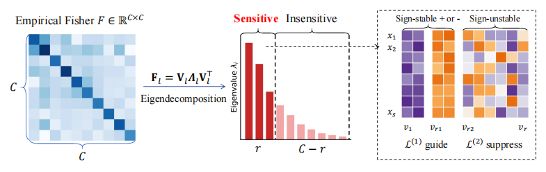

# SubRot: Signed Gradient Subspace Calibration for VLM Rotation Quantization.
The code repository contains the code for [SubRot: Signed Gradient Subspace Calibration for VLM Rotation Quantization.](https://arxiv.org/abs/2609.34884v1)

## Abstract
Post-training quantization reduces the deployment cost of vision-language models (VLMs), but preserving multimodal capabilities at low bit widths remains challenging. Existing methods rely on modality- or token-level gradient statistics, which are susceptible to cross-sample variations in visual-to-textual token ratios and the positions of visual information, limiting statistical stability. Moreover, overly coarse aggregation through absolute values and averaging discards gradient signs and channel-wise differences, limiting the separation of modality-specific sensitivities. In contrast, the channel space provides a shared coordinate system across samples, making it a more natural basis for capturing stable task-sensitive structures. We therefore propose SubRot, a signed gradient subspace calibration method for VLM rotation quantization. Through eigendecomposition of the empirical Fisher matrix of activation gradients, SubRot identifies a sensitive channel subspace with three properties: cross-sample stability, clear sensitivity separation, and consistent signed effects on the autoregressive loss along certain directions. Guided by a local Taylor expansion, SubRot combines signed first-order guidance along sign-stable directions with second-order constraints along the remaining sensitive directions, while retaining MSE for overall reconstruction quality. This objective steers quantization errors toward loss-decreasing directions while controlling their magnitude. Experiments on five VLMs across five benchmarks show consistent average-score improvements over FlatQuant under W4A6 and W4A4, reaching 1.4 percentage points on LLaVA-NeXT-7B. Under W4A4, average accuracy degradation from FP16 remains within 1.4 percentage points across all evaluated models, while LLaVA-v1.5-13B exceeds its FP16 average score by 0.4 percentage points.


## Usage
Environment Setup:

```
git clone https://github.com/chairman-lu/SubRot.git
cd SubRot
conda create -n subrot python=3.10
conda activate subrot
bash set_env.sh
```

Then follow the [LLaVA evaluation guide](https://github.com/haotian-liu/LLaVA/blob/main/docs/Evaluation.md) to prepare [ScienceQA (Train)](https://github.com/SAI-Lab-NYU/QSVD/blob/main/myllava/docs/QSVD_DATA.md).

Calibration and evaluation:

```
bash run.sh
```

## Citation
```
@article{shang2026subrot,
  title={SubRot: Signed Gradient Subspace Calibration for VLM Rotation Quantization},
  author={Shang, Zhenhao and Jing, Haizhao and Zhang, Haokui and Wei, Guoting and Xiao, Rong and Gao, Jianqing and Wang, Peng},
  journal={arXiv preprint arXiv:2609.34884},
  year={2026}
}
```

## Acknowledgements
This project is based on the work of the following projects:

- [Quarot](https://github.com/spcl/QuaRot)
- [FlatQuant](https://github.com/ruikangliu/FlatQuant)
- [QSVD](https://github.com/SAI-Lab-NYU/QSVD/tree/main)

We are grateful for the contributions provided by these projects.